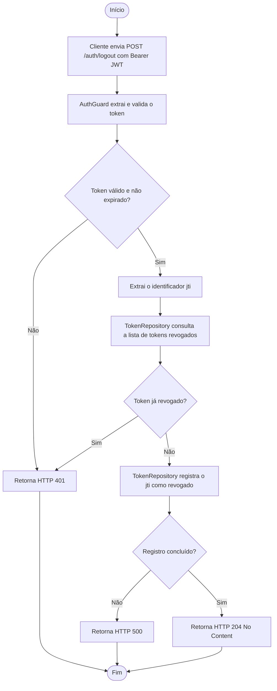

# Fluxo — REQ 04: Logout

## Observações

- O endpoint `POST /auth/logout` responde com status **HTTP 204 No Content** quando a revogação do token é processada com sucesso.
- O `TokenRepository` atual utiliza implementação em memória (`InMemoryTokenRepository`), armazenando os identificadores `jti` revogados em um `Set<string>`.
