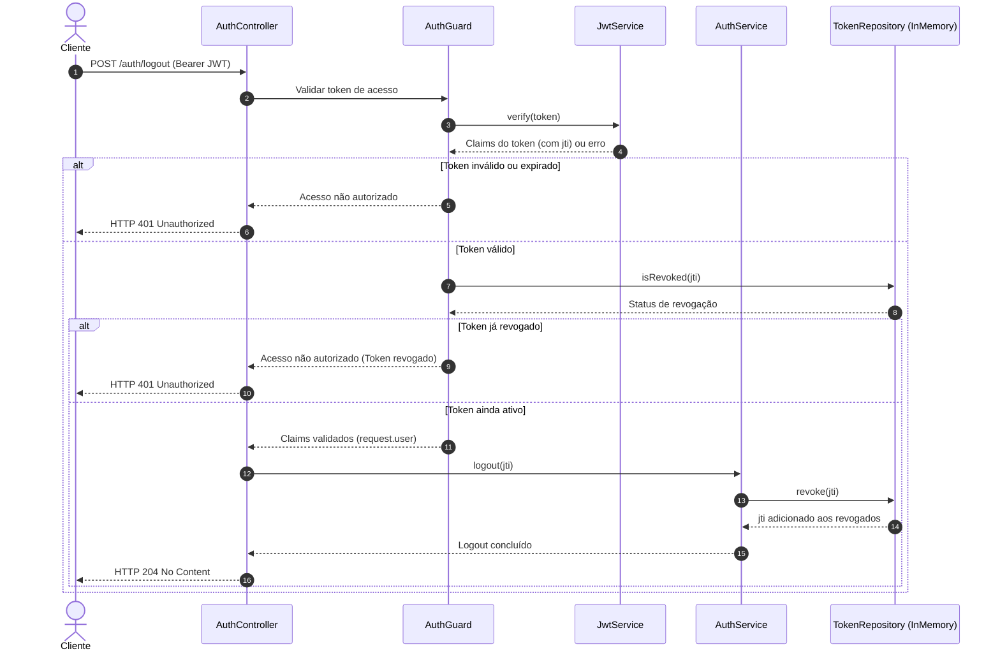

# Diagrama de sequência — REQ 04: Logout

## Observações

- A implementação em `dev` utiliza `@HttpCode(204)` no `AuthController.logout`, retornando **HTTP 204 No Content** sem corpo de resposta.
- A lista de revogação reside atualmente no `InMemoryTokenRepository` utilizando uma estrutura `Set<string>`. Em versões futuras de produção, poderá ser conectada a um repositório distribuído com expiração automática (TTL via Redis ou banco de dados relacional).
