# UML — Serviço de Contas (Accounts)

```mermaid
classDiagram
    direction TB

    class AccountsController {
        +create(dto: CreateAccountDto) AccountResponseDto
    }

    class AuthController {
        +login(dto: LoginDto) AuthResponseDto
        +logout(token: string) void
    }

    class AccountsService {
        +createAccount(dto: CreateAccountDto) Account
        +findByEmail(email: string) Account
    }

    class AuthService {
        +login(dto: LoginDto) AuthResponseDto
        +logout(token: string) void
    }

    class Account {
        +id: string
        +name: string
        +email: string
        +passwordHash: string
        +cpf: string
        +oab: string
        +type: UserType
        +createdAt: Date
    }

    class UserType {
        <<enumeration>>
        COMMON
        LAWYER
    }

    class CreateAccountDto {
        +name: string
        +email: string
        +password: string
        +cpf: string
        +oab: string
        +type: UserType
    }

    class LoginDto {
        +email: string
        +password: string
    }

    class AccountResponseDto {
        +id: string
        +name: string
        +email: string
        +cpf: string
        +oab: string
        +type: UserType
        +createdAt: Date
    }

    class AuthResponseDto {
        +accessToken: string
        +tokenType: string
        +expiresIn: number
        +account: AccountResponseDto
    }

    class JwtPayload {
        +sub: string
        +email: string
        +type: UserType
        +iat: number
        +exp: number
        +jti: string
    }

    class AccountsRepository {
        <<interface>>
        +findByEmail(email: string) Account
        +findByCpf(cpf: string) Account
        +create(account: Account) Account
    }

    class JsonAccountsRepository {
        +findByEmail(email: string) Account
        +findByCpf(cpf: string) Account
        +create(account: Account) Account
    }

    class TokenRepository {
        <<interface>>
        +isRevoked(jti: string) boolean
        +revoke(jti: string) void
    }

    class JsonTokenRepository {
        +isRevoked(jti: string) boolean
        +revoke(jti: string) void
    }

    class PasswordHasher {
        <<interface>>
        +hash(password: string) string
        +compare(password: string, hash: string) boolean
    }

    class Argon2PasswordHasher {
        +hash(password: string) string
        +compare(password: string, hash: string) boolean
    }

    class JwtService {
        +sign(payload: JwtPayload) string
        +verify(token: string) JwtPayload
    }

    class AuthGuard {
        +canActivate() boolean
    }

    class AccountsJsonFile {
        accounts.json
    }

    class RevokedTokensJsonFile {
        revoked-tokens.json
    }

    AccountsController --> AccountsService
    AuthController --> AuthService

    AccountsService --> AccountsRepository
    AccountsService --> PasswordHasher
    AuthService --> AccountsRepository
    AuthService --> PasswordHasher
    AuthService --> JwtService
    AuthService --> TokenRepository

    JsonAccountsRepository ..|> AccountsRepository
    JsonTokenRepository ..|> TokenRepository
    Argon2PasswordHasher ..|> PasswordHasher

    JsonAccountsRepository --> AccountsJsonFile
    JsonTokenRepository --> RevokedTokensJsonFile

    AuthGuard --> JwtService
    AuthGuard --> TokenRepository

    Account --> UserType
    CreateAccountDto --> UserType
    AccountResponseDto --> UserType
    JwtPayload --> UserType
```

## Observações

1. `AccountsRepository`, `TokenRepository` e `PasswordHasher` são interfaces. Isso permite substituir suas implementações sem alterar os serviços que dependem delas.
2. A senha original não deve ser armazenada. A entidade `Account` mantém somente `passwordHash`.
3. O campo `oab` é aplicável a contas do tipo `LAWYER`.
4. Nesta implementação inicial, `AuthGuard` está representado dentro do Serviço de Contas, sem um API Gateway. Essa é uma simplificação em relação à arquitetura prevista na ADR-0007.
5. A persistência em arquivos JSON é provisória e pressupõe, nesta etapa, uma execução controlada com uma única instância da aplicação.
