# UML — Serviço de Contas (Accounts)

```mermaid
classDiagram
    direction TB

    class AccountsController {
        +create(dto: CreateAccountDto) AccountResponseDto
    }

    class AuthController {
        +login(dto: LoginDto) AuthResponseDto
        +logout(token: string) void
    }

    class AccountsService {
        +createAccount(dto: CreateAccountDto) Account
        +findByEmail(email: string) Account
    }

    class AuthService {
        +login(dto: LoginDto) AuthResponseDto
        +logout(token: string) void
    }

    class Account {
        +id: string
        +name: string
        +email: string
        +passwordHash: string
        +cpf: string
        +oab: string
        +type: UserType
        +createdAt: Date
    }

    class UserType {
        <<enumeration>>
        COMMON
        LAWYER
    }

    class CreateAccountDto {
        +name: string
        +email: string
        +password: string
        +cpf: string
        +oab: string
        +type: UserType
    }

    class LoginDto {
        +email: string
        +password: string
    }

    class AccountResponseDto {
        +id: string
        +name: string
        +email: string
        +cpf: string
        +oab: string
        +type: UserType
        +createdAt: Date
    }

    class AuthResponseDto {
        +accessToken: string
        +tokenType: string
        +expiresIn: number
        +account: AccountResponseDto
    }

    class JwtPayload {
        +sub: string
        +email: string
        +type: UserType
        +iat: number
        +exp: number
        +jti: string
    }

    class AccountsRepository {
        <<interface>>
        +findByEmail(email: string) Account
        +findByCpf(cpf: string) Account
        +create(account: Account) Account
    }

    class JsonAccountsRepository {
        +findByEmail(email: string) Account
        +findByCpf(cpf: string) Account
        +create(account: Account) Account
    }

    class TokenRepository {
        <<interface>>
        +isRevoked(jti: string) boolean
        +revoke(jti: string) void
    }

    class InMemoryTokenRepository {
        -Set~string~ _revokedTokens
        +isRevoked(jti: string) boolean
        +revoke(jti: string) void
    }

    class JsonAccountsRepository {
        +findByEmail(email: string) Account
        +findByCpf(cpf: string) Account
        +create(account: Account) Account
    }

    class PasswordHasher {
        <<interface>>
        +hash(password: string) string
        +compare(password: string, hash: string) boolean
    }

    class Argon2PasswordHasher {
        +hash(password: string) string
        +compare(password: string, hash: string) boolean
    }

    class JwtService {
        -string _secret
        -NestJwt _jwt
        +number expiresInSeconds
        +sign(data: Pick~JwtPayload, 'sub' | 'email' | 'type'~) string
        +verify(token: string) JwtPayload
    }

    class AuthGuard {
        -JwtService _jwtService
        -TokenRepository _tokenRepository
        +canActivate(context: ExecutionContext) boolean
    }

    class AccountsJsonFile {
        accounts.json
    }

    AccountsController --> AccountsService
    AuthController --> AuthService

    AccountsService --> AccountsRepository
    AccountsService --> PasswordHasher
    AuthService --> AccountsRepository
    AuthService --> PasswordHasher
    AuthService --> JwtService
    AuthService --> TokenRepository

    JsonAccountsRepository ..|> AccountsRepository
    InMemoryTokenRepository ..|> TokenRepository
    Argon2PasswordHasher ..|> PasswordHasher

    JsonAccountsRepository --> AccountsJsonFile

    AuthGuard --> JwtService
    AuthGuard --> TokenRepository

    Account --> UserType
    CreateAccountDto --> UserType
    AccountResponseDto --> UserType
    JwtPayload --> UserType
```

## Observações

1. `AccountsRepository`, `TokenRepository` e `PasswordHasher` são interfaces desacopladas. Isso permite substituir suas implementações sem alterar os serviços dependentes.
2. A entidade `Account` armazena exclusivamente `passwordHash`, nunca a senha em texto puro. O `AccountResponseDto` não expõe a senha nem seu hash.
3. O campo `oab` é obrigatório para contas do tipo `LAWYER` e nulo para `COMMON`. A entidade valida essa restrição lançando exceção caso violada.
4. O `TokenRepository` está implementado como `InMemoryTokenRepository` utilizando `Set<string>` para controle de tokens revogados (`jti`) em memória durante o logout (`POST /auth/logout`, retornando HTTP 204). A persistência de longo prazo ou distribuída (Redis/PostgreSQL) poderá ser acoplada futuramente através da mesma interface.
5. O `PasswordHasher` possui implementação inline temporária nos serviços para prototipação e deverá ser substituído pela implementação concreta com Argon2 conforme previsto na ADR-0001.
6. A persistência em `accounts.json` via `JsonAccountsRepository` é provisória para execução local controlada em instância única.
7. O `AuthGuard` reside temporariamente no próprio serviço de contas para proteger endpoints internos (como `/auth/logout`), enquanto o API Gateway centralizado (ADR-0007) não é introduzido.
